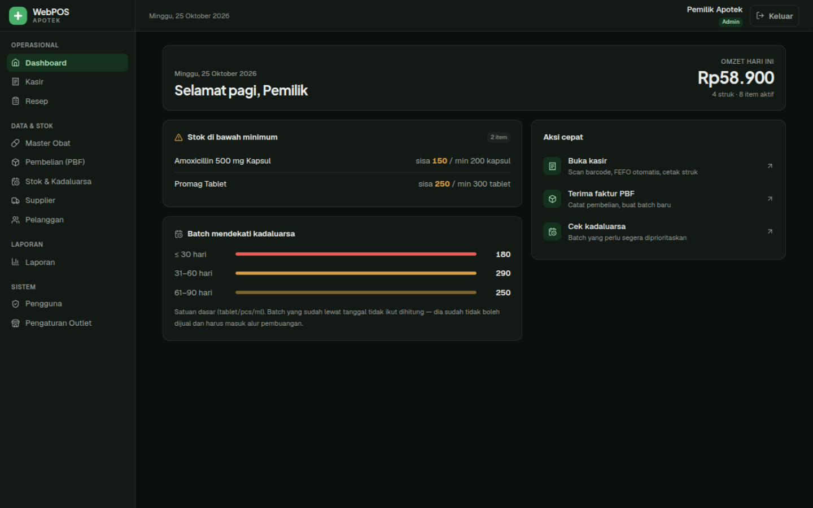
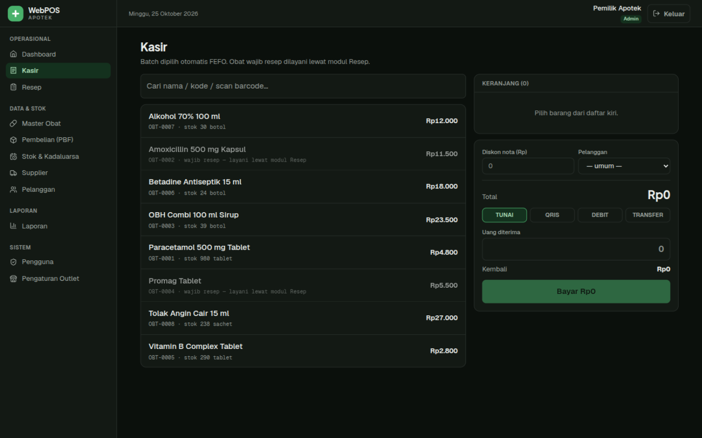
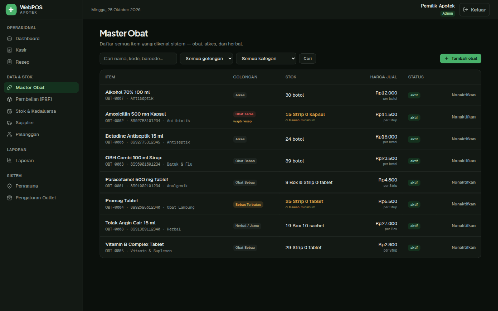
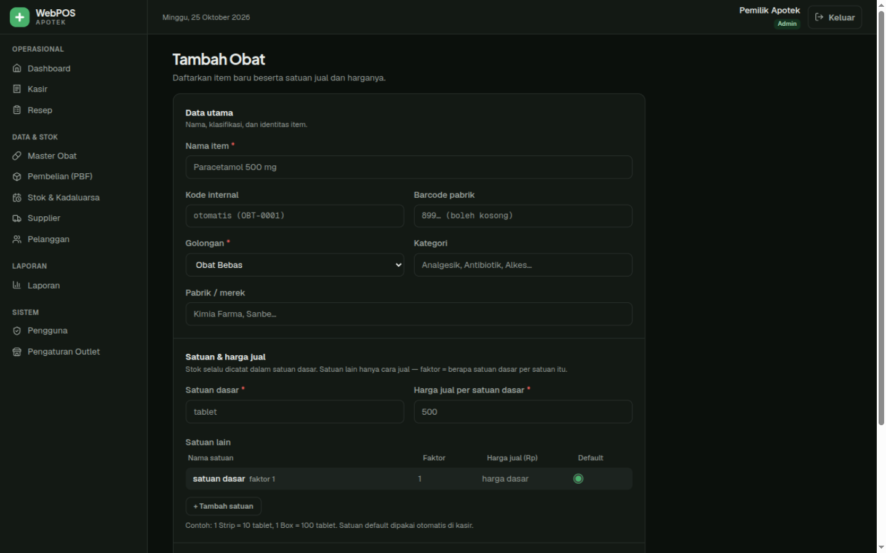
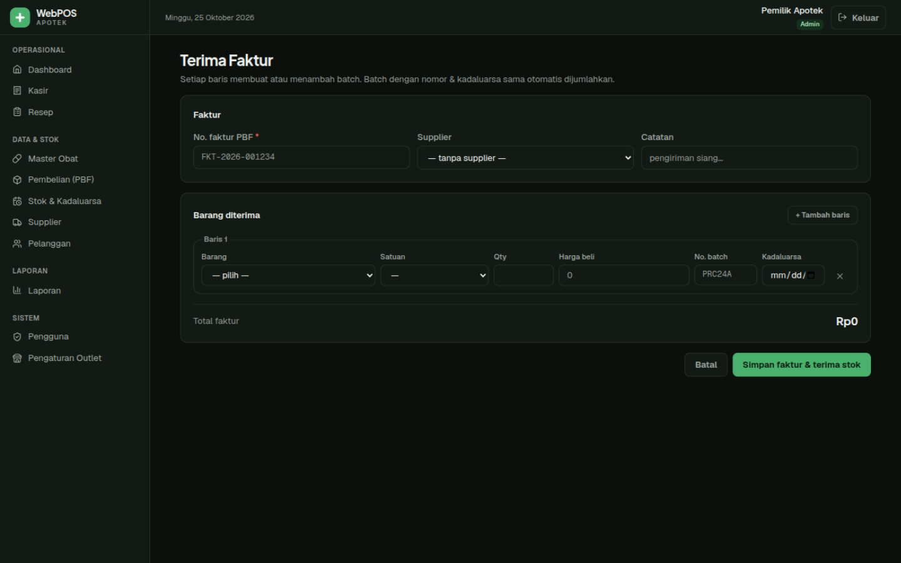
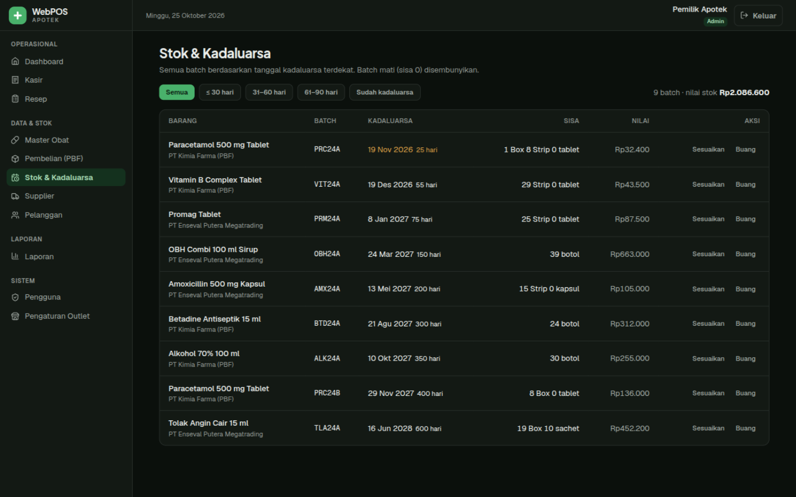
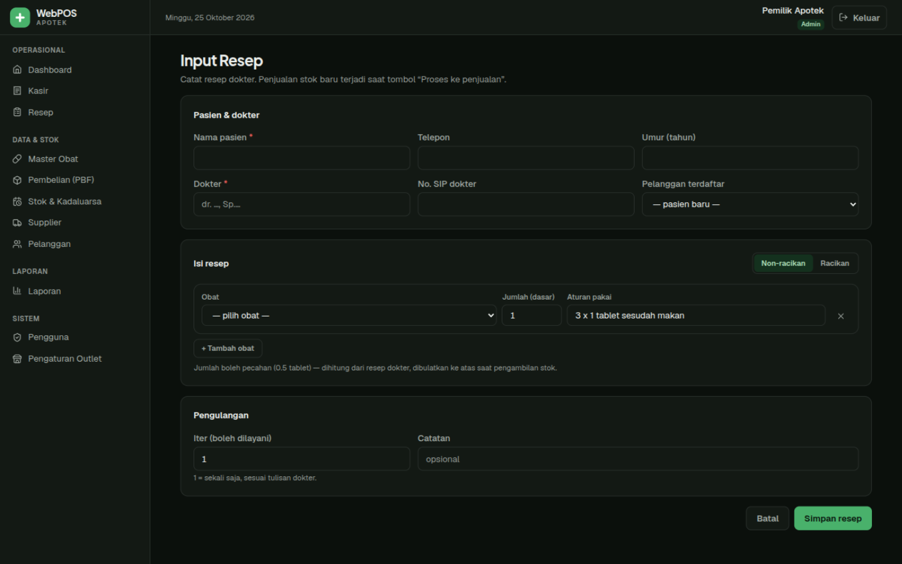
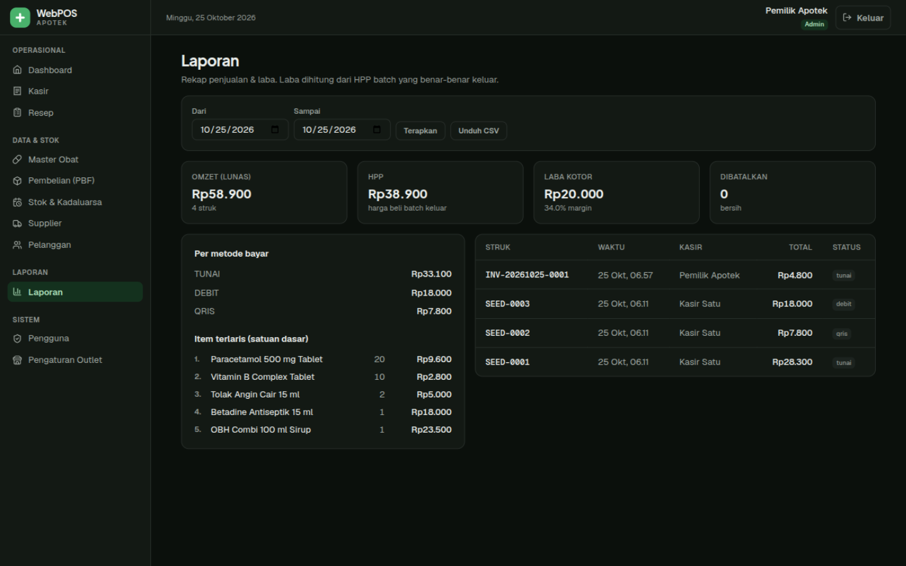
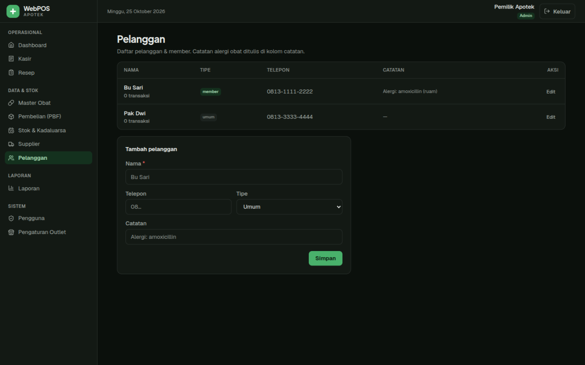
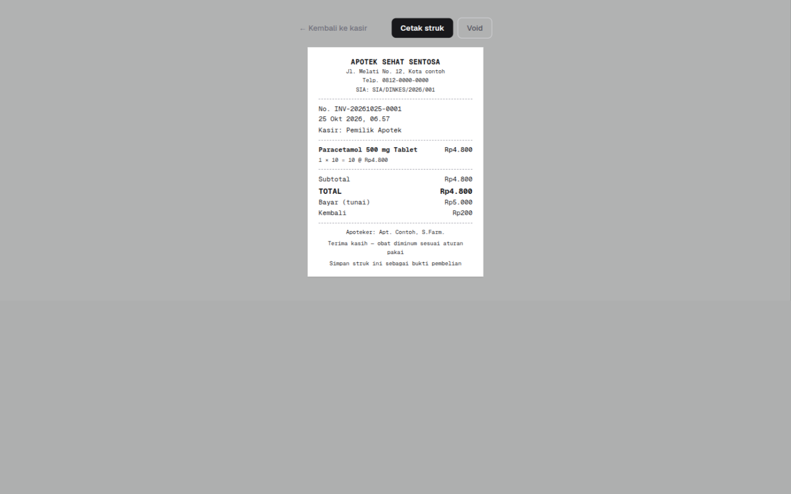

# 💊 WebPOS Apotek

Aplikasi kasir & manajemen apotek berbasis web — dibangun khusus untuk cara kerja apotek Indonesia: **stok per batch dengan FEFO**, **resep & racikan dengan signa**, **multi-satuan jual (Box/Strip/Tablet)**, dan **laba dihitung dari batch yang benar-benar keluar**.

Dibangun dengan **Next.js 16 (App Router, Server Actions)**, **Prisma + SQLite**, **Tailwind CSS v4**, dan **TypeScript**. Tanpa dependency auth eksternal — sesi berbasis cookie HMAC, password scrypt. Data tersimpan lokal di laptop apotek, **tetap jalan tanpa internet**.

---

## 🖼️ Tampilan Aplikasi

### Dashboard
Ringkasan harian: omzet, item aktif, meter batch mendekati kadaluarsa (≤30/31–60/61–90 hari), daftar stok di bawah minimum, dan aksi cepat.



### Kasir (POS)
Pencarian live nama/kode/scan barcode, keranjang dengan pilihan satuan jual, diskon nota, 4 metode bayar (TUNAI/QRIS/DEBIT/TRANSFER), chip saran nominal + hitung kembali otomatis. **Alokasi batch FEFO diputuskan di server** — kasir tidak pernah memilih batch.



### Master Obat
Daftar item dengan pencarian case-insensitive (nama/kode/barcode), filter golongan & kategori, stok ditampilkan ramah-kasir (`9 Box 9 Strip`), badge golongan berwarna sesuai risiko regulasi, dan soft-delete (nonaktifkan) yang aman terhadap histori penjualan.



Form item dengan **editor multi-satuan**: faktor konversi + harga per satuan + pilihan satuan default kasir. Golongan keras otomatis menandai wajib resep.



### Terima Faktur (Pembelian PBF)
Satu-satunya jalur stok masuk. Tiap baris membuat/menambah batch (item + no. batch + kadaluarsa yang sama otomatis dijumlahkan, bukan dobel). Harga beli per satuan dasar dihitung agar HPP tidak pernah lebih mahal dari nyata.



### Stok & Kadaluarsa
Semua batch urut kadaluarsa dengan filter bucket, nilai rupiah stok berisiko, penyesuaian stok (opname) dan pembuangan (EXPIRED/RUSAK/RETUR_PBF) yang semuanya tercatat di ledger.



### Resep
Pintu legal penjualan obat keras/psikotropika. Non-racikan (jumlah pecahan + signa preset "3 × 1 tablet sesudah makan") dan racikan (bahan stok/non-stok, takaran, jumlah dosis). Kontrol **iter**: resep hanya boleh dilayani sebanyak yang dokter izinkan.



### Laporan
Rentang tanggal bebas: omzet, **HPP dari batch yang benar-benar keluar**, laba kotor + margin, breakdown metode bayar, item terlaris, riwayat struk, dan **export CSV** (aman dibuka Excel Indonesia).



### Pelanggan
Data pelanggan & member dengan catatan alergi obat.



### Struk 58mm
Struk thermal siap cetak langsung dari browser: kop apotek + SIA, detail `qty × faktor = satuan dasar`, bayar/kembali, apoteker penanggung jawab, dan catatan kaki. Struk void ditandai dengan alasan.



---

## ✨ Fitur Lengkap

| Modul | Fungsi |
|-------|--------|
| **Autentikasi & RBAC** | Login cookie HMAC (12 jam, seumur shift), password scrypt + salt, proteksi route per role di proxy *dan* di server action (dua lapis), user nonaktif otomatis ditendang walau tokennya hidup |
| **Dashboard** | Omzet hari ini, jumlah struk, item aktif, meter batch ≤30/31–60/61–90 hari, stok di bawah minimum, aksi cepat |
| **Master Obat** | CRUD item + pencarian/filter + paginasi; **multi-satuan** (faktor Box→Strip→Tablet) dengan harga per satuan; validasi: tepat 1 satuan dasar, faktor bulat ≥1, nama unik, hanya 1 default; peringatan otomatis bila harga antar satuan janggal; soft-delete |
| **Pembelian (PBF)** | Faktur multi-baris → `Purchase` + `PurchaseItem` + **upsert batch** + `StockMovement`; batch identik dijumlahkan; harga beli per satuan dasar dibulatkan ke bawah |
| **Stok & Kadaluarsa** | Daftar batch per bucket kadaluarsa + nilai berisiko; **opname** (selisih ± alasan wajib); **disposal** (EXPIRED/RUSAK/RETUR_PBF); **kartu stok** per item dari ledger append-only dengan saldo berjalan |
| **Kasir** | Cari/scan → keranjang → **FEFO otomatis di server** → diskon nota → 4 metode bayar → saran nominal → struk 58mm siap cetak → **void dengan alasan** (stok kembali ke batch, `VOID_SALE`); obat wajib resep ditolak dengan arahan ke modul Resep |
| **Resep** | Pasien + dokter + SIP; non-racikan (qty pecahan, signa preset/parse) & racikan (bahan stok/non-stok, dosis); **iter** dengan hitungan pelayanan; proses → penjualan `RX-…` + struk |
| **Laporan** | Periode bebas: omzet, HPP per batch, laba kotor + margin %, per metode bayar, item terlaris, export **CSV** |
| **Pengguna** | Buat akun + role, reset password, nonaktifkan; tidak bisa mengunci diri sendiri |
| **Supplier / Pelanggan** | CRUD; supplier tak terhapus bila punya riwayat; pelanggan dengan tipe member & catatan alergi |
| **Pengaturan Outlet** | Identitas apotek, SIA/SIPA, footer struk — terpakai di struk & laporan |

### Aturan domain yang dijaga kode

1. **Uang = integer rupiah utuh.** Nol float, nol desimal — total struk tidak pernah meleset 1 rupiah.
2. **Stok = integer satuan dasar** (tablet/pcs/ml). Box/Strip hanya cara jual; konversi via `faktor`.
3. **FEFO, bukan FIFO.** Batch dengan kadaluarsa terdekat keluar lebih dulu; batch kedaluwarsa tidak boleh dijual dan tidak ikut stok layak.
4. **Ledger append-only.** `StockMovement` tidak pernah di-update/di-delete — kartu stok selalu bisa direkonsiliasi.
5. **Snapshot histori.** `SaleItem` menyimpan `namaSnapshot`, `faktor`, dan `hargaSatuan` saat transaksi — mengubah master tidak merusak struk lama.
6. **Obat keras hanya lewat resep.** Ditegakkan di server, bukan cuma di UI.

---

## 🔐 Role & Hak Akses

| Modul | ADMIN | APOTEKER | KASIR |
|-------|:-----:|:--------:|:-----:|
| Dashboard, Kasir, Master Obat, Pelanggan | ✅ | ✅ | ✅ |
| Resep, Pembelian, Stok, Supplier, Laporan | ✅ | ✅ | ❌ |
| Pengguna, Pengaturan Outlet | ✅ | ❌ | ❌ |
| Void struk, proses resep, opname, disposal | ✅ | ✅ | ❌ |

Akun contoh dari seed (⚠️ ganti sebelum dipakai sungguhan):

| Role | Email | Password |
|------|-------|----------|
| ADMIN | `admin@apotek.test` | `admin123` |
| APOTEKER | `apoteker@apotek.test` | `apoteker123` |
| KASIR | `kasir@apotek.test` | `kasir123` |

---

## 🚀 Menjalankan

```bash
npm install
cp .env.example .env          # isi SESSION_SECRET: openssl rand -hex 32
npm run db:migrate            # buat database SQLite + tabel
npm run db:seed               # outlet, 3 user, 2 supplier, 8 obat + batch, 2 pelanggan, 3 penjualan contoh
npm run dev                   # http://localhost:3000
```

Seed **idempoten** — aman dijalankan ulang; penjualan contoh dibuat sekali saja (penanda `SEED-`).

| Script | Fungsi |
|--------|--------|
| `npm run dev` / `build` / `start` | development / build produksi / jalankan produksi |
| `npm run test` | unit test (vitest): uang, FEFO, satuan, password, sesi |
| `npm run lint` | ESLint |
| `npm run db:migrate` | Prisma migrate dev |
| `npm run db:seed` | Isi data awal |
| `npm run db:studio` | Buka Prisma Studio (lihat data mentah) |

---

## 🏗️ Struktur Proyek

```
prisma/
  schema.prisma        # skema DB + keputusan desain di komentar
  seed.ts              # data awal idempoten
  migrations/
src/
  proxy.ts             # proteksi route Next 16 (pengganti middleware)
  app/
    login/             # halaman masuk
    (dash)/            # seluruh aplikasi setelah login (sidebar + header)
      page.tsx         #   dashboard
      kasir/           #   layar POS + keranjang client
      obat/            #   master obat: daftar, baru, [id]
      pembelian/       #   faktur PBF: daftar, baru, [id]
      stok/            #   batch, sesuaikan, buang, kartu stok
      resep/           #   daftar, baru, [id] + proses ke penjualan
      laporan/         #   ringkasan periode + riwayat
      pelanggan/ supplier/ pengguna/ pengaturan/
    struk/[id]/        # struk 58mm siap cetak (di luar shell agar print bersih)
    actions/           # server actions per modul (semuanya verifikasi role sendiri)
    laporan/penjualan.csv/  # route handler export CSV
  lib/
    money.ts           # uang integer, hitung total, saran bayar
    fefo.ts            # alokasi FEFO, stok layak jual, HPP per batch
    units.ts           # multi-satuan: validasi, konversi, format stok
    signa.ts           # aturan pakai, etiket, iter
    session.ts auth.ts # sesi HMAC + Data Access Layer
    password.ts        # scrypt hash/verify
    db.ts              # PrismaClient singleton
  components/icons.tsx # ikon SVG inline (tanpa emoji)
docs/screenshots/      # tangkapan layar (dipakai README ini)
```

---

## 🧪 Yang Sudah Diverifikasi

- Unit test **14/14 lulus** (aritmetika uang, alokasi FEFO, validasi satuan, scrypt, HMAC session).
- Build produksi & ESLint bersih.
- Alur kasir end-to-end di browser: cari → keranjang → bayar tunai Rp5.000 → struk `INV-…` → **FEFO terbukti di database** (batch dengan kadaluarsa terdekat yang terpakai, stok batch itu yang berkurang).
- Proteksi role: kasir ditolak di `/pengguna`, cookie dimanipulasi ditolak, tanpa login dialihkan ke `/login`.

## 🗺️ Rencana Berikutnya

- PWA + offline-first (kasir tetap jalan saat internet mati)
- Backup/restore satu klik (file SQLite)
- Pemecahan stok bahan racikan otomatis saat resep diproses
- Multi-outlet (relasi `outletId` sudah disiapkan di seluruh tabel)
- Shift kasir: buka/tutup shift + selisih kas

## 📄 Lisensi

Pribadi — dibuat untuk kebutuhan apotek. Sesuaikan sebelum dipakai produksi.
